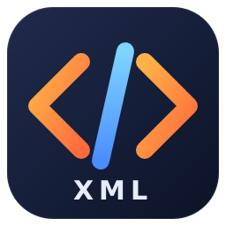

<p align="center">
  
</p>

<h1 align="center">XML Language Support</h1>

<p align="center">
  Rich XML editing for Visual Studio Code, powered by the Language Server Protocol.
</p>

<p align="center">
  
  
  
</p>

---

## Overview

**XML Language Support** is a lightweight VS Code client that connects the editor to
an XML language server. All the smart editing features come from the server, while
this extension takes care of starting it, keeping it in sync with your workspace, and
wiring it into VS Code.

> **Preview release.** This is an early `0.1.0` version. Expect rough edges and
> missing settings; please [report problems](https://github.com/harshanacz/xml-language-client/issues).

## Highlights

- **Works out of the box** with `.xml`, `.xsd` and `.xsl` files.
- **Syntax checking** that reports mismatched tags and undefined entities as you type.
- **Schema-aware editing** for `pom.xml`, `web.xml`, `persistence.xml` and Spring bean files, using built-in XSDs.
- **Local schemas**: a document that declares `xsi:noNamespaceSchemaLocation` or
  `xsi:schemaLocation` pointing at a local `.xsd` is validated against it.
- **Editor features**: completion, hover, outline, folding, formatting, rename, go to definition and references.
- **Self-contained packaging**: the language server ships inside the extension (`server/`),
  so no extra setup is needed once installed from a `.vsix`.
- **Workspace aware**: watches `**/*.xml` so the server stays up to date as files change.
- **Lightweight**: activates only when an XML document is opened.

## Supported files

| Extension | Description           |
| --------- | --------------------- |
| `.xml`    | XML documents         |
| `.xsd`    | XML Schema documents  |
| `.xsl`    | XSL stylesheets       |

## Requirements

- Visual Studio Code `1.85.0` or newer.

## Known limitations (0.1.0)

- There are no extension settings yet, so custom schema associations cannot be configured from VS Code.
- Only documents saved as files are supported; untitled editors are not.

## How it works

```text
┌──────────────┐   LSP over stdio   ┌───────────────────────┐
│   VS Code    │ ◀────────────────▶ │  XML language server  │
│  (this ext.) │                    │      (server.js)      │
└──────────────┘                    └───────────────────────┘
```

When an XML file is opened, the extension looks for the server in this order:

1. `server/server.js` bundled inside the extension (packaged builds).
2. `../xml-language-server/dist/server.js` next to this repository (development checkouts).

## Development setup

The server depends on the service by relative path, so clone all three side by side:

```bash
mkdir xml-workspace
cd xml-workspace

git clone https://github.com/harshanacz/xml-language-service.git
git clone https://github.com/harshanacz/xml-language-server.git
git clone https://github.com/harshanacz/xml-language-client.git

cd xml-language-service
npm install
npm run build

cd ../xml-language-server
npm install
npm run bundle

cd ../xml-language-client
npm install
npm run build
```

Then open `xml-language-client` in VS Code, run the **Launch Extension** debug
configuration (or press `F5`), and open an XML file in the Extension Development Host.

### Useful scripts

| Script                | What it does                                         |
| --------------------- | ---------------------------------------------------- |
| `npm run build`       | Type-checks and compiles with `tsc`.                 |
| `npm run build:watch` | Recompiles on every change.                          |
| `npm run bundle`      | Bundles the extension into `dist/extension.js`.      |
| `npm run package`     | Creates an installable `.vsix` package.              |

## Troubleshooting

| Problem                                  | Fix                                                                                     |
| ---------------------------------------- | --------------------------------------------------------------------------------------- |
| Server module cannot be found            | Make sure `server/server.js` exists, or that `../xml-language-server/dist/server.js` is built. |
| Extension opens but XML features are off | Confirm the file language mode (bottom right of VS Code) is set to **XML**.            |
| Need server logs                         | Open the **Output** panel and pick `xml-language-server` from the dropdown.            |

## Links

- [Report an issue](https://github.com/harshanacz/xml-language-client/issues)
- [Language server](https://github.com/harshanacz/xml-language-server)
- [Language service](https://github.com/harshanacz/xml-language-service)
